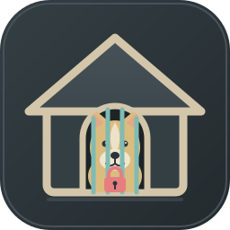

<p align="center">
  
</p>

# Lassie's Doghouse

A deliberately witty name for a serious jail: Collie is the dog, and the jail is
the doghouse.

This is a Nix flake for running [ColliePWA](https://github.com/AltanS/collie) as
a **network- and filesystem-jailed** `systemd --user` service, with an optional
tailnet HTTPS front door and an allowlisted Web Push egress proxy.

Collie is a phone web UI for the AI agents running in your terminal. Upstream
normally starts it as a Herdr plugin with a writable checkout and outbound
network access. This flake keeps the useful part — the bridge and the PWA — and
removes the rest:

- the bridge runs in its own network namespace with only `lo`;
- `$HOME` is an empty tmpfs with a small set of read-only bind mounts;
- only the state directory is writable;
- self-update is disabled twice over (read-only store, packaged install);
- Web Push is the one outbound exception, through a host-side CONNECT proxy
  that only reaches the push services in an allowlist.

The result is a phone UI that can reach the agents on your machine without
giving a compromised web front a route to the internet, your SSH keys, or your
home directory.

## Requirements

- Nix with flakes enabled.
- Linux with systemd user services. The jail relies on `PrivateNetwork=`,
  `ProtectHome=tmpfs`, and `systemd-socket-proxyd`; this is not a Darwin module.
- A Herdr socket at `~/.config/herdr/herdr.sock` (or set
  `HERDR_SOCKET_PATH` through `services.collie.environment`).
- Optional: Tailscale with MagicDNS and HTTPS certificates enabled, for the
  `tailscale serve` front door.

## Flake outputs

| Output | Purpose |
| --- | --- |
| `packages.<system>.collie` | Source-built Collie, the `collie-bridge` wrapper, and the web bundle. |
| `packages.<system>.default` | Alias for `collie`. |
| `homeManagerModules.default` (and `.collie`) | The `services.collie` home-manager module. |
| `nixosModules.collie-serve` (and `.default`) | The `services.collie-serve` NixOS module. |
| `devShells.<system>.default` | `bun2nix`, `bun`, `alejandra`, `statix`, `deadnix`, `nixd`. |
| `formatter.<system>` | `alejandra`. |

## Installation

Add the flake as an input. Pin `nixpkgs` to the same revision your system uses
so the package does not build against a second copy:

```nix
{
  inputs = {
    nixpkgs.url = "github:nixos/nixpkgs/nixpkgs-unstable";

    lassies-doghouse = {
      url = "github:butzist/lassies-doghouse";
      inputs.nixpkgs.follows = "nixpkgs";
    };
  };
}
```

### Home-manager

Import the module and enable the service. The defaults keep the bridge on
loopback and make the state directory private:

```nix
{
  imports = [
    inputs.lassies-doghouse.homeManagerModules.default
  ];

  services.collie = {
    enable = true;

    # The exact Host header the reverse proxy forwards. Collie's allowlist is
    # fail-closed, so a tailscale serve front door needs this.
    publicHosts = ["legion.baboon-macaroni.ts.net"];

    # Optional, but recommended if you want phone notifications.
    pushProxy.enable = true;
  };
}
```

If you want the history/files views to work, add the paths explicitly. Nothing
outside this list is visible inside the jail:

```nix
services.collie.readOnlyPaths = [
  "%h/.local/share/opencode" # OpenCode session history
  "%h/.claude/projects"      # Claude Code transcripts
  "%h/.pi"                   # pi/omp session logs
  "%h/src"                   # project folders, for Files/Changes
];

# Or read-write, e.g. if the "new pane in a new worktree" flow should work:
# services.collie.readWritePaths = ["%h/src"];
```

### NixOS: tailnet HTTPS front door

The home-manager service speaks plain HTTP on `127.0.0.1:8787`. This module
runs `tailscale serve` **outside** the jail and terminates HTTPS on the
machine's MagicDNS name:

```nix
{
  imports = [
    inputs.lassies-doghouse.nixosModules.collie-serve
  ];

  services.collie-serve.enable = true;

  # Allow the operator, not only root, to talk to tailscaled. `collie pair`
  # uses this to resolve the MagicDNS URL and draw a scannable QR code.
  services.tailscale.extraSetFlags = ["--operator=work"];
}
```

Access is then `https://<host>.<tailnet>.ts.net/`. In the Tailscale admin
console, MagicDNS must be on, HTTPS certificates must be enabled, and the ACL
must let the phone reach this host on port 443. Do **not** use
`tailscale funnel`: serve is tailnet-only, funnel is public internet.

If you already run a reverse proxy, keep `services.collie.listenAddress` on
loopback and point the proxy at `127.0.0.1:8787` instead; you do not need the
NixOS module. In that case, still set `publicHosts` to the Host header the
proxy forwards.

## Configuration

### `services.collie`

| Option | Default | Meaning |
| --- | --- | --- |
| `enable` | `false` | Install the package and start the jailed bridge. |
| `package` | this flake's `collie` | Package to run. Override only if you build your own. |
| `port` | `8787` | Host port the HTTP front door listens on. |
| `listenAddress` | `127.0.0.1` | Host address for the front door. Keep loopback unless another proxy fronts it. |
| `publicHosts` | `[]` | Exact Host headers accepted through a reverse proxy, written to `COLLIE_PUBLIC_HOSTS`. |
| `readOnlyPaths` | `[]` | Extra host paths bind-mounted read-only into the jail. |
| `readWritePaths` | `[]` | Extra host paths bind-mounted read-write into the jail. |
| `extraPackages` | `[]` | Extra binaries on the bridge's `PATH`. |
| `environment` | `{}` | Extra environment variables. They cannot widen the netns or mounts. |
| `pushProxy.enable` | `false` | Start the host-side Web Push CONNECT proxy and wire the bridge to it. |
| `pushProxy.allowHosts` | FCM, Mozilla, Apple, Windows Push | Host suffixes the proxy may reach on port 443. |

### `services.collie-serve`

| Option | Default | Meaning |
| --- | --- | --- |
| `enable` | `false` | Publish the loopback front door with `tailscale serve`. |
| `port` | `8787` | The loopback port the home-manager module listens on. |
| `httpsPort` | `443` | HTTPS port tailscale serve listens on. Keep 443 unless you also add the port to `publicHosts`. |

## Pairing

Start the service, then pair from the same user's shell:

```bash
systemctl --user start collie-push-proxy
systemctl --user start collie

collie pair
```

`collie pair` reads the state directory and talks to the bridge through the
loopback front door. It prints a URL and a pairing code; open the URL on the
phone and enter the code in Settings.

If the CLI cannot read tailscaled (for example, the operator flag is not set),
give it the public URL explicitly:

```bash
COLLIE_PUBLIC_URL=https://legion.baboon-macaroni.ts.net collie pair
```

## Web Push

Web Push needs outbound HTTPS to the endpoint the browser chose. Instead of
giving the bridge a route, the flake runs a host-side CONNECT proxy on a Unix
socket in the shared state directory. The bridge's `web-push` calls point at a
loopback relay started by `collie-bridge`; the relay forwards to the proxy; the
proxy accepts only `CONNECT` to port 443 on `pushProxy.allowHosts`.

Generate a VAPID key pair (once), then restart the services:

```bash
cfg="${XDG_CONFIG_HOME:-$HOME/.config}/collie"
install -d -m 700 "$cfg"

HERDR_PLUGIN_CONFIG_DIR="$cfg" collie push-keys mailto:you@example.com

systemctl --user restart collie-push-proxy
systemctl --user restart collie
```

Enable notifications on the phone: **Settings → Alerts**. Then send a test
push from the host:

```bash
HERDR_PLUGIN_CONFIG_DIR="$cfg" \
COLLIE_STATE_DIR="${XDG_STATE_HOME:-$HOME/.local/state}/collie" \
collie push test
```

`collie push test` runs outside the jail and uses the host's normal network, so
it tests the subscription and the push service, not the proxy. To exercise the
proxy path, trigger a real agent event after enabling alerts.

If a push service is rejected, its hostname appears in the proxy log:

```bash
journalctl --user -u collie-push-proxy -b
```

Add the rejected suffix to `services.collie.pushProxy.allowHosts` and rebuild.

## Operations

```bash
# Status
systemctl --user status collie collie-http.socket collie-push-proxy --no-pager

# Logs
journalctl --user -u collie -b -n 50
journalctl --user -u collie-push-proxy -b -n 50

# Restart after changing settings or keys
systemctl --user restart collie-push-proxy
systemctl --user restart collie
```

The unit names are `collie.service`, `collie-http.socket`,
`collie-http.service`, and (with push enabled) `collie-push-proxy.service`.

Do **not** use `collie start`, `collie stop`, or `collie restart` with this
deployment. Those commands write `~/.config/systemd/user/collie.service`, which
would replace the home-manager-managed unit. Use `systemctl --user` instead.

Do **not** install the upstream `herdr.collie` plugin. It would create a second
checkout and a competing service. Herdr is only the multiplexer here; the
bridge talks to `HERDR_SOCKET_PATH` directly. The `restart` hint printed by
`collie push-keys` assumes a Herdr-managed install; ignore it.

## Updating Collie

1. Change `version` and the `src` hash in `packages/collie.nix`:

   ```bash
   nix-prefetch-url --unpack \
     https://github.com/AltanS/collie/archive/refs/tags/vX.Y.Z.tar.gz
   ```

2. From a checkout of the new tag, regenerate both Bun dependency sets with the
   pinned `bun2nix` from `nix develop`. Point the output paths at your
   `lassies-doghouse` checkout, not at the upstream tree:

   ```bash
   cd /path/to/collie-vX.Y.Z

   bun2nix -l bun.lock \
     -o /path/to/lassies-doghouse/packages/collie-bun.nix

   (cd web && bun2nix -l bun.lock \
     -o /path/to/lassies-doghouse/packages/collie-web-bun.nix)
   ```

3. Re-apply `packages/collie-push-proxy.patch` to the new tag, or re-spin it if
   `bridge/push.ts` moved. The build fails loudly if the patch no longer
   applies, which is intentional.

4. Build and test:

   ```bash
   nix build .#collie
   ./result/bin/collie --version
   ```

## Development

```bash
nix develop
nix build .#collie
nix flake check
nix fmt
```

The package pins Bun `1.4.4` (upstream's minimum at the time of writing).
`bun build --compile` copies the running Bun into the binary, so the override
matters for the runtime the package carries. Only the archive and version move;
the rest of the derivation is nixpkgs'.

## Troubleshooting

**The service refuses to start with `private network namespace is missing`.**
The user manager did not create the netns. Check that user namespaces and
systemd's `PrivateNetwork=` work on the host; the bridge fails closed rather
than running with host networking.

**The phone gets a blank page or a Host-header error.**
Set `services.collie.publicHosts` to the exact Host header the proxy forwards.
For `tailscale serve` that is the MagicDNS name, without a trailing port when
the front door is on 443.

**`collie pair` prints a localhost URL.**
The CLI cannot read tailscaled. Set `services.tailscale.extraSetFlags =
["--operator=<user>"]` or pass `COLLIE_PUBLIC_URL=...` explicitly.

**Push works from `collie push test` but not from an agent event.**
Check `journalctl --user -u collie | grep '\[push\]'` and
`journalctl --user -u collie-push-proxy -b`. The proxy is the enforcement
point; `collie push test` bypasses it.

**`herdr plugin action invoke restart --plugin herdr.collie` returns
`plugin_not_found`.**
Expected. This flake does not install the Herdr plugin. Use
`systemctl --user restart collie`.

## Security notes

- The bridge never has a route: `PrivateNetwork=yes` leaves only `lo`. DNS and
  arbitrary outbound sockets fail.
- The host reaches the bridge through a `0600` Unix socket; the only listener
  on host loopback is `systemd-socket-proxyd`.
- `$HOME` is an empty tmpfs. Only `~/.config/collie`, `~/.config/herdr`, and the
  opt-in `readOnlyPaths`/`readWritePaths` are mounted back in.
- The state directory is `0700` and holds pairing tokens, push subscriptions,
  uploads, and the audit log.
- Web Push is client-supplied. The host proxy's allowlist, not Collie, is what
  prevents a hostile subscription endpoint from turning the sender into an
  arbitrary HTTPS client. Keep the allowlist narrow.
- `COLLIE_ACCOUNT_WINDOWS=off` prevents the account-windows feature from
  reading Claude/OpenCode credentials and calling their APIs.
- `COLLIE_SKIP_SERVE=1` keeps the bridge out of `tailscale serve`; the NixOS
  module owns that.
- Never expose the loopback front door directly to the internet. Use
  `tailscale serve`, not `tailscale funnel`.

## License

The packaging and modules in this flake are MIT-licensed. Collie itself is MIT
and lives at <https://github.com/AltanS/collie>.
